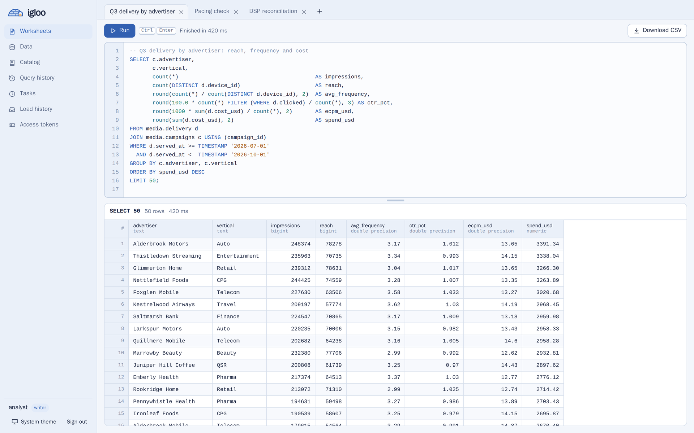
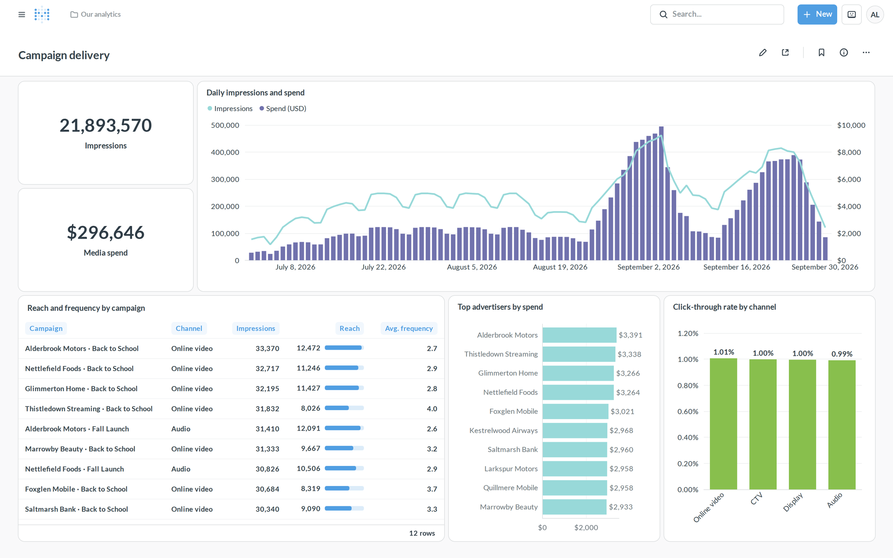
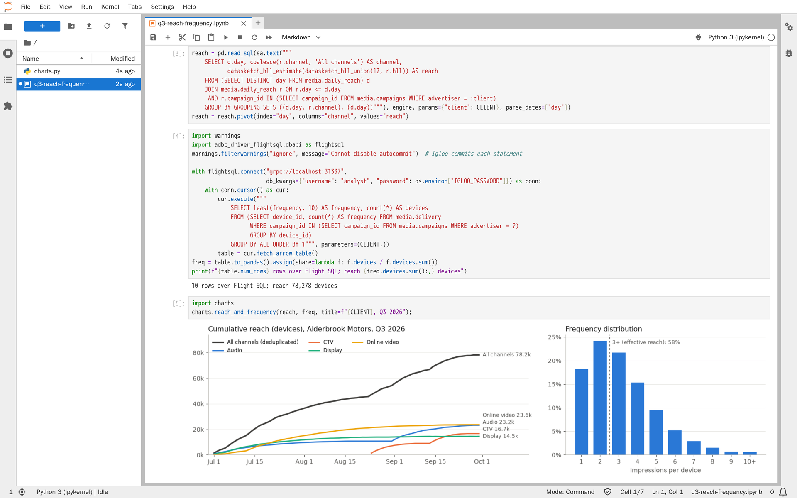

<p align="center">
  
</p>

# Igloo

Igloo is an open-source SQL data warehouse that runs in your own cloud
account or on your own hardware.

Igloo runs 3 times faster than Snowflake and Databricks at 25 times lower
cost, and is faster and lower cost at every warehouse size from X-Small to
X-Large. The 3 and 25 are medians over those sizes, on TPC-H at 100 GB in
Amazon S3 at list prices, with Igloo on one machine: 32 cores against
X-Small and Small, 64 from Medium up. See the [benchmark](bench/README.md)
for the method, every result and its caveats.

- **Postgres-compatible.** Clients connect over the PostgreSQL wire protocol,
  so `psql`, JDBC, psycopg, pgx, dbt, BI tools and notebooks work without an
  Igloo driver.
- **Arrow-native extracts.** [Arrow Flight SQL](docs/flight-sql.md) streams
  results to pandas, polars, Spark and BI tools as Arrow record batches,
  through ADBC or the Flight SQL JDBC driver, several times faster than the
  PostgreSQL protocol.
- **Open table format.** Tables are [Apache Iceberg](https://iceberg.apache.org/)
  in object storage (S3, GCS, Azure Data Lake Storage, or any S3-compatible
  store), with no proprietary storage to migrate out of. Spark, Trino and
  PyIceberg read and write them through Igloo's
  [Iceberg REST catalog](docs/external-engines.md), under Igloo's users and
  grants.
- **Efficient by design.** Queries run on an embedded
  [DuckDB](https://duckdb.org/), and most analytical workloads fit on one
  machine. You pay for your own machines and storage, with no credits to buy.
- **AI and forecasting in SQL.** [Forecasts](docs/ml-functions.md#foundation-models)
  on Amazon's Chronos and Google's TimesFM run inside Igloo, with no model
  to train and no data leaving, and [AI functions](docs/ai-functions.md)
  call the model provider you choose, priced and capped before they run.
- **Know what runs before you move.** A [migration report](docs/migrating.md)
  replays your Snowflake or Databricks query history on Igloo and shows what
  runs, whether the answers match, and what it would cost.
- **Runs anywhere.** Docker Compose for one machine, a Helm chart for any
  Kubernetes cluster, and OpenTofu modules that stand up the whole stack on
  AWS, Google Cloud or Azure.

<p align="center">
  <picture>
    <source media="(prefers-color-scheme: dark)" srcset="docs/assets/screenshots/console-worksheet-dark.png">
    
  </picture>
</p>

<table>
  <tr>
    <td width="50%"></td>
    <td width="50%"></td>
  </tr>
  <tr>
    <td align="center"><sub>Metabase through the PostgreSQL driver</sub></td>
    <td align="center"><sub>Jupyter with SQLAlchemy and Arrow Flight SQL</sub></td>
  </tr>
</table>

<sub>Screenshots use synthetic data from
<code>deploy/single-vm/sql/load-media.sql</code>; the companies in it are
invented.</sub>

Licensed under [Apache 2.0](LICENSE).

## Quick start

Requires Docker with Compose v2.20 or later.

```sh
make up      # generates deploy/single-vm/.env with random secrets and starts the stack
make psql    # SQL shell as the admin user
```

```sql
CREATE TABLE events (id INTEGER, kind VARCHAR, at_time TIMESTAMP);
INSERT INTO events VALUES (1, 'signup', now()), (2, 'login', now());
SELECT kind, count(*) FROM events GROUP BY kind;
```

Any Postgres client can connect to `127.0.0.1:5433` as user `igloo` with the
password `IGLOO_ADMIN_PASSWORD` from `deploy/single-vm/.env` (`make up`
generates it; Igloo refuses to create the account with a placeholder such
as `change-me` or fewer than 16 characters):

```sh
psql "host=127.0.0.1 port=5433 user=igloo dbname=igloo"
```

Or open the [web console](docs/console.md) at `http://127.0.0.1:8443` and sign
in with the same user and password, or fetch results as Arrow over
[Flight SQL](docs/flight-sql.md) at `grpc://localhost:31337`:

```python
import adbc_driver_flightsql.dbapi as flightsql

with flightsql.connect("grpc://localhost:31337",
                       db_kwargs={"username": "igloo", "password": "..."}) as conn, conn.cursor() as cur:
    cur.execute("SELECT * FROM events")
    df = cur.fetch_df()  # or fetch_arrow_table(), or polars.read_database(query, conn)
```

Try it on real data with the TPC-H benchmark:

```sh
make load-tpch    # scale factor 1: 6 million lineitem rows
make tpch         # runs and times all 22 TPC-H queries
```

On a laptop, the scale factor 1 load takes about 20 seconds and the 22
queries take about 4 seconds in total with warm caches; their results match
the official TPC-H answers.

## What you get

- **Iceberg tables** with `CREATE [OR REPLACE] TABLE`, `CREATE TABLE AS`,
  `INSERT`, `UPDATE`, `DELETE`, `MERGE`, `DROP`, schemas, views, comments,
  and time travel (`SELECT * FROM t AT (TIMESTAMP => TIMESTAMP '2026-10-01 00:00')`).
- **[Zero-copy clones](docs/sql.md#clones)** of tables and schemas: a full copy of production to develop and test against, made in
  seconds without copying data, with the source's policies; and Iceberg
  [branches and tags](docs/sql.md#branches-and-tags) of tables.

  ```sql
  CREATE OR REPLACE SCHEMA dbt_ana CLONE analytics;
  CREATE TABLE dev.orders CLONE prod.orders AT (TIMESTAMP => now() - INTERVAL 1 DAY);
  ALTER TABLE prod.orders CREATE TAG q3_close;
  ```
- **Users, roles and grants**: SCRAM-SHA-256 passwords, built-in roles for
  the whole warehouse, and custom roles with grants on schemas and tables,
  all managed in SQL.

  ```sql
  CREATE USER ana WITH PASSWORD 'a-long-password' ROLE writer;  -- admin, writer, reader or none
  CREATE USER nora WITH PASSWORD 'another-password' ROLE none;
  CREATE ROLE analysts;
  GRANT analysts TO nora;
  GRANT SELECT ON SCHEMA marts TO analysts;
  ```
- **[Single sign-on](docs/sso.md)** to the web console with Okta, Microsoft
  Entra ID, Google Workspace or any OpenID Connect provider, with users
  created at first sign-in (or provisioned with SCIM) and the provider's
  groups mapped to roles; **access tokens** that BI tools, dbt and scripts
  send instead of a password; and **service accounts** for programs.

  ```sql
  GRANT analysts TO SSO GROUP 'Data Team';
  CREATE USER dbt_prod TYPE SERVICE ROLE none;
  CREATE TOKEN ci FOR USER dbt_prod EXPIRES '90d';   -- shown once, stored hashed
  ```
- **[Row access and masking policies, and tags](docs/security-policies.md)**:
  show each team only its clients' rows, and mask emails,
  device IDs and other identifiers for everyone not allowed to see them,
  in every statement, the web console included.

  ```sql
  CREATE ROW ACCESS POLICY client_rows AS (cid VARCHAR) RETURNS BOOLEAN ->
    EXISTS (SELECT 1 FROM governance.client_access a
            WHERE a.client_id = cid AND is_role_in_session(a.role_name));
  ALTER TABLE marts.impressions ADD ROW ACCESS POLICY client_rows ON (client_id);
  CREATE MASKING POLICY mask_pii AS (val VARCHAR) RETURNS VARCHAR ->
    CASE WHEN is_role_in_session('pii_reader') THEN val ELSE sha256(val) END;
  CREATE TAG pii ALLOWED_VALUES 'email', 'device_id';
  ALTER TAG pii SET MASKING POLICY mask_pii;
  ALTER TABLE marts.impressions ALTER COLUMN email SET TAG pii = 'email';
  ```
- **[Delta Sharing](docs/sharing.md)**, both ways: share tables with clients
  and partners, who read them with Spark, pandas, Power BI or Tableau
  through the open protocol, and query partners' shares as
  external tables, with grants as for any table.

  ```sql
  CREATE SHARE acme_reporting;
  ALTER SHARE acme_reporting ADD TABLE marts.campaign_daily;
  CREATE RECIPIENT acme;                       -- returns a one-time activation link
  GRANT SELECT ON SHARE acme_reporting TO RECIPIENT acme;
  CREATE EXTERNAL TABLE partners.viewership FROM SHARE tvco_ads.tv.viewing.daily;
  ```
- **[Connections to other databases](docs/federation.md)**: query
  PostgreSQL, MySQL and Snowflake databases in place, read-only, and join
  them with Iceberg tables, with filters pushed down to them and their
  tables governed by the same grants and policies, or copy them into
  Iceberg tables with `CREATE TABLE AS`.

  ```sql
  CREATE CONNECTION crm TYPE postgres WITH (host 'crm.example.com', database 'crm', user 'igloo_ro', password '...');
  GRANT SELECT ON SCHEMA crm.public TO analysts;
  SELECT count(*) FROM audiences a JOIN crm.public.customers c ON c.email = a.email;
  ```
- **[Erasure of personal data](docs/privacy.md)** for GDPR and CCPA
  requests: one statement deletes a person's rows from every table whose
  columns are tagged with their identifiers, hashed ones included, rewrites
  the files that held them, expires the snapshots that still reference
  them, deletes them from object storage and every replica's read cache,
  redacts the query history and verifies that nothing is left, with a
  record that shows it but not whose data it was. Data retentions limit how
  long tables keep old versions of rows.

  ```sql
  GRANT ERASE ON ACCOUNT TO privacy_officer;
  ERASE SUBJECT WHERE pii.email = 'ann@example.com' OR pii.device_id = '6F9619FF-8B86-D011-B42D-00C04FC964FF';
  SELECT status, verification FROM igloo.erasure_requests;
  ALTER TABLE marts.impressions SET (data_retention_days = 30);
  ```
- **[Clean rooms](docs/clean-rooms.md)** with publishers, retailers and TV
  makers: audience overlap, reach and frequency, and conversion lift on
  data joined by hashed emails or device IDs, through templates every party
  approves, with thresholds on every result row, and neither side seeing
  the other's rows. Partners take part over HTTP with their Delta Sharing
  token.

  ```sql
  ALTER CLEAN ROOM tv ADD TEMPLATE overlap
    FROM BUILTIN audience_overlap (left => crm.email_sha256, right => exposures.email_sha256, by => crm.segment) RUN BY (agency);
  RUN CLEAN ROOM tv TEMPLATE overlap;
  ```
- **Query and login history** in `igloo.query_history` and
  `igloo.login_history`: every statement and login, kept for 90 days, with
  each statement's CPU time, bytes and memory.
- **[Data catalog](docs/catalog.md)**: search tables by name, description,
  column, tag and owner; owners and descriptions of schemas, tables and
  columns; size and freshness from the Iceberg metadata; usage and
  table-level lineage worked out from the query history, external tables
  and connections' tables included, also sent to OpenLineage tools such as
  Marquez and DataHub. Each user sees only the tables they may read.

  ```sql
  COMMENT ON TABLE marts.daily_spend IS 'Spend per client, campaign and day';
  ALTER TABLE marts.daily_spend OWNER TO analytics_eng;
  SELECT upstream_name, last_seen, last_job FROM igloo.lineage WHERE downstream_name = 'daily_spend';
  ```
- **[Loading and scheduling](docs/loading.md)** with nothing else to run:
  `COPY INTO` loads CSV, TSV, Parquet and JSON drops from a bucket, each
  file once; pipes load new files as they land; tasks run SQL on a cron or
  interval schedule in any time zone; materialized views keep a query's
  result as a table. Everything runs as its owner, and a scaled-to-zero
  Igloo is started when work is due.

  ```sql
  COPY INTO sales FROM 's3://drops/sales/' (FORMAT csv, PATTERN '.*[.]csv[.]gz');
  CREATE TASK nightly SCHEDULE '0 6 * * *' TIMEZONE 'America/New_York' AS
    CREATE OR REPLACE TABLE report AS SELECT day, sum(spend) FROM sales GROUP BY day;
  ```
- **[Alerts and notifications](docs/alerts.md)** to Slack, Microsoft
  Teams, email and webhooks: alerts run a query on a schedule, as their
  owner and through their owner's policies, and notify when it returns
  rows; built-in alerts report failed runs and loads, pipes whose files
  stopped arriving, long queries, failed-login bursts and maintenance
  failures. Notifications reach only public addresses over TLS, and
  webhook URLs are stored encrypted.

  ```sql
  CREATE NOTIFICATION INTEGRATION ops_slack TYPE slack URL 'https://hooks.slack.com/services/...'
    OPERATIONAL_ALERTS = (FAILED_RUNS, IDLE_PIPES = 26);
  GRANT USAGE ON INTEGRATION ops_slack TO ROLE analysts;
  CREATE ALERT pacing SCHEDULE '0 9 * * MON-FRI' IF (EXISTS (
      SELECT campaign FROM marts.pacing WHERE abs(spend / planned - 1) > 0.2))
    THEN NOTIFY ops_slack MESSAGE 'Pacing is off plan for {{campaign}}' WITH RESULT;
  ```
- **[Media analytics](docs/media-analytics.md)**: HLL and theta sketches
  that merge into deduplicated reach and audience overlap across campaigns,
  platforms and days; geometry and H3 functions for DMA, zip code and
  store-radius reporting; DuckDB's approximate, statistical and time zone
  functions.
- **[Other engines](docs/external-engines.md)** through an Iceberg REST
  catalog on port 8181: Spark, Trino and PyIceberg sign in as Igloo users, Igloo's grants decide what they may read and change,
  their requests go to the query history, and they get storage credentials
  that last an hour and reach one table's files only.
- **[Workload management](docs/workload-management.md)**: query tags
  (`SET query_tag = 'client:acme'`), per-client usage and estimated cost in
  `igloo.usage`, per-role concurrency, timeout and memory limits
  (`ALTER ROLE analysts SET max_concurrent_statements = 4`), and compute
  pools that give a client or team compute and a bill of its own.
- **A locked-down query engine**: SQL cannot read the server's files or reach
  any location except the warehouse and locations you allow.
- **Automatic table maintenance**: small files are compacted, snapshots older
  than the retention (7 days by default) are expired, and unreferenced files
  are deleted, with nothing to schedule.
- **Several replicas** behind one endpoint, all reading and writing the same
  tables; concurrent writes to a table are retried automatically.
- **[Scale to zero](docs/scale-to-zero.md)**: a small gateway stops Igloo's
  machines or pods when nobody uses them and starts them when a client
  connects, on AWS, Google Cloud, Azure or Kubernetes.
- **[Distributed execution](docs/distributed-execution.md)**: a query over
  a very large table runs in parts on worker machines that Igloo starts when
  it needs them and stops when they are idle, with the same grants, sandbox
  and results as on one machine.
- **[Read cache](docs/operations.md#read-cache)**: table files read from
  object storage are kept on local disk across restarts, so the first
  queries after a start (or a scale-to-zero resume) do not fetch them again.
- **[Web console](docs/console.md)** at `http://127.0.0.1:8443`: SQL
  worksheets, a data browser, a catalog with lineage graphs, query history,
  tasks and loads, and user and compute administration, signed in with the
  same users as SQL clients.
- **[Arrow Flight SQL](docs/flight-sql.md)** at `grpc://localhost:31337`:
  query results as DuckDB's Arrow record batches for ADBC (pandas, polars),
  pyarrow and the Flight SQL JDBC driver, with the same users, grants,
  timeouts and history as SQL clients.
- **[Your tools, unchanged](docs/integrations.md)**: dbt with the standard
  dbt-postgres adapter (incremental models, snapshots, tests, docs),
  Metabase, Superset, Power BI, Tableau and Looker through their PostgreSQL
  connectors, and SQLAlchemy, pandas and polars in notebooks, tested on
  every release.
- **Operations basics**: health and readiness endpoints, Prometheus metrics,
  JSON logs, statement timeouts, connection limits, TLS, query cancel.

## Deploy

| Where | How |
|---|---|
| One machine (laptop, VM, on-prem server) | [deploy/single-vm](deploy/single-vm/docker-compose.yml) with Docker Compose: `make up` |
| Any Kubernetes cluster | [Helm chart](deploy/helm/igloo/README.md) |
| AWS (EKS, S3, RDS) | [deploy/aws](deploy/aws/README.md) OpenTofu module |
| Google Cloud (GKE, GCS, Cloud SQL) | [deploy/gcp](deploy/gcp/README.md) OpenTofu module |
| Azure (AKS, ADLS Gen2, PostgreSQL Flexible Server) | [deploy/azure](deploy/azure/README.md) OpenTofu module |

The single-machine stack can keep tables in Amazon S3 instead of the bundled
local store; see the bottom of `deploy/single-vm/.env`.

## How it works

```
 psql / JDBC / BI tool          pandas / polars / Spark (ADBC), Flight JDBC
          │  PostgreSQL wire protocol      │  Arrow Flight SQL
          │  (SCRAM, optional TLS)         │  (TLS, or localhost only)
          │            ┌───────────────────┘
          ▼            ▼
 ┌──────────────────────┐   Iceberg REST   ┌────────────┐     ┌────────────┐
 │ igloo (1..n replicas)│ ───────────────▶ │ Lakekeeper │ ──▶ │ PostgreSQL │
 │  DuckDB inside       │                  │  catalog   │     │  metadata  │
 └──────────────────────┘                  └────────────┘     └────────────┘
          │  Parquet data and Iceberg metadata                       ▲
          ▼                                                          │
 ┌─────────────────────────────────────────────┐        users and roles
 │ Object storage: S3, GCS, ADLS, S3-compatible │        (schema "igloo_auth")
 └─────────────────────────────────────────────┘
```

- **igloo** (this repository, Go) accepts Postgres and Arrow Flight SQL
  connections, checks each statement against the user's role and grants,
  and runs it on an embedded DuckDB attached to the catalog. On start it
  sets up the catalog and warehouse itself, so every deployment works the
  same way.
- **[Lakekeeper](https://github.com/lakekeeper/lakekeeper)** is the Iceberg
  REST catalog: it tracks tables, schemas and snapshots. Only Igloo talks to
  it; other engines use Igloo's own Iceberg REST endpoint (port 8181), which
  checks their requests against the same users and grants and passes them
  on.
- **PostgreSQL** stores the catalog's metadata and Igloo's users.
- **Object storage** holds the table data as Parquet files.

Every component uses a permissive open-source license (Apache 2.0, MIT or the
PostgreSQL License), except two libraries under the LGPL 2.1 inside DuckDB's
extensions: GEOS in the spatial extension (see
[media analytics](docs/media-analytics.md#security)), and MariaDB
Connector/C, the MySQL client library, in the `mysql` extension.

## Documentation

- [Product principles](docs/principles.md): what Igloo optimizes for, in order
- [Configuration](docs/configuration.md): every setting
- [Web console](docs/console.md): worksheets, data browser, history and
  administration in the browser, and their security
- [Arrow Flight SQL](docs/flight-sql.md): fast columnar results for ADBC,
  pandas, polars and JDBC, and their security
- [Single sign-on](docs/sso.md): identity providers, access tokens for SQL
  clients, service accounts
- [Operations](docs/operations.md): sizing, scaling, users, monitoring,
  backups, table maintenance, upgrades, troubleshooting
- [Scale to zero](docs/scale-to-zero.md): stop compute when idle and start it
  on the next connection
- [Other engines](docs/external-engines.md): Spark, Trino and PyIceberg on
  Igloo's tables, through its Iceberg REST catalog
- [Distributed execution](docs/distributed-execution.md): queries larger than
  one machine, run in parts on workers
- [SQL and clients](docs/sql.md): the SQL dialect, Iceberg features, type
  mapping, tested drivers and tools
- [Snowflake SQL](docs/snowflake-sql.md): Snowflake's dialect for a session,
  so queries, dashboards and dbt models written for Snowflake run without
  being rewritten
- [Loading and scheduling](docs/loading.md): `COPY INTO`, pipes, tasks and
  materialized views
- [Alerts and notifications](docs/alerts.md): alerts, notification
  integrations for Slack, Teams, email and webhooks, and built-in
  operational alerts
- [Masking, row access policies and tags](docs/security-policies.md): what
  each user sees of tables' rows and columns
- [Data catalog](docs/catalog.md): descriptions, owners, freshness, usage
  and lineage, and OpenLineage
- [Erasing personal data](docs/privacy.md): GDPR and CCPA erasure
  requests, the record they keep, data retention, and what they do not
  reach
- [Media analytics](docs/media-analytics.md): reach and frequency with
  sketches, geospatial reporting, approximate and statistical functions
- [ML functions](docs/ml-functions.md): forecasting, anomaly detection,
  classification and other models, trained and scored in SQL
- [AI functions](docs/ai-functions.md): completion, classification,
  extraction and decision models in SQL, through your own model provider
- [Model pack](docs/models.md): the open-weight forecasting models Igloo
  runs itself
- [Workload management](docs/workload-management.md): query tags, usage and
  cost per client, role limits, compute pools
- [Delta Sharing](docs/sharing.md): sharing tables with outside recipients,
  reading partners' shares, and their security
- [Connections](docs/federation.md): querying PostgreSQL and MySQL
  databases in place, and governing them with grants
- [Tools and integrations](docs/integrations.md): dbt, BI tools and
  notebooks, how to connect each and what to expect
- [Clean rooms](docs/clean-rooms.md): measuring with partners on joined
  data neither sees, templates and approvals, thresholds, and what they
  protect against
- [Benchmark](bench/README.md): price-performance against Snowflake and
  Databricks on the same data and queries
- [Migrating from Snowflake or Databricks](docs/migrating.md): a report on
  how much of a real workload runs on Igloo, from its query history
- [Security](SECURITY.md): the security model and how to report a
  vulnerability
- [Contributing](CONTRIBUTING.md)

## Limitations in 1.0

- **Distribution covers the common big shapes.** A query over a very large
  table runs in parts on [workers](docs/distributed-execution.md) when it
  scans, filters, aggregates and joins it to smaller tables, to another large
  table or to itself on equal columns, and when it reads it again in a
  correlated `EXISTS`, `NOT EXISTS` or aggregate subquery by equal columns,
  which run as the joins they mean: TPC-DS q09, q10, q16, q32, q35, q69, q92
  and q94 among them. Three large tables joined on different keys, aggregates
  that do not combine (`median`, `string_agg`) and window functions over rows
  still run on one replica; give it a large memory-optimized machine and fast
  spill disk for those.
- **Grants stop at tables.** Views run with the querying user's privileges,
  and there are no column privileges: use masking policies instead. Table
  and column names are visible to every user through the system catalogs
  (descriptions, owners, usage and lineage only to those who may see the
  table). Policies do not bind admins, who manage them, nor engines that
  read the Iceberg tables directly.
- **Lineage is table-level.** It comes from the statements Igloo runs; there
  is no column-level lineage, and what other engines do to the tables
  directly is not seen ([details](docs/catalog.md#lineage)).
- **Scale to zero saves node costs on one machine, not yet in the cloud
  modules.** The AWS, Google Cloud and Azure modules run Igloo on their
  general node pool, so scaling its pods to zero does not release nodes
  ([details](docs/scale-to-zero.md#on-kubernetes)).
- **Branches are read-only.** Writes go to a table's `main` branch. Other
  engines can write to branches, which Igloo reads and fast-forwards `main`
  to; for changes made in Igloo, clone the table.
- **Keys are not enforced.** `PRIMARY KEY` and `UNIQUE` on Iceberg tables are
  accepted but not checked, so duplicates are possible. `NOT NULL` is
  enforced.
- **Other engines get storage credentials on S3 only.** On Google Cloud
  Storage and Azure, engines using the Iceberg REST catalog need their own
  access to the files ([details](docs/external-engines.md#storage-credentials)).
- **Connections attach at startup.** A new connection to another database
  is attached when each replica next restarts; changes to its credentials
  and host apply at once. Connections are read-only, and BigQuery is not
  supported yet ([details](docs/federation.md)).

## Repository layout

```
cmd/igloo/          server entry point and subcommands
internal/audit/     query and login history
internal/auth/      users, roles, grants, SCRAM verifiers, access tokens
internal/console/   web console
internal/erasure/   erasure of people's data across the warehouse
internal/scim/      SCIM 2.0 provisioning of users and groups
internal/sso/       single sign-on with OpenID Connect
internal/catalog/   catalog and warehouse setup
internal/cleanroom/ clean rooms: templates, policies, runs, the partner API
internal/clone/     zero-copy clones, the files they share, branches and tags
internal/config/    environment-variable configuration
internal/distributed/ queries in parts on workers: planner, coordinator, worker
internal/engine/    embedded DuckDB, storage, sandbox
internal/federation/ connections to other databases and their proxy
internal/flightsql/ Arrow Flight SQL endpoint
internal/icebergrest/ Iceberg REST catalog for other engines
internal/notify/    notification integrations, sending, built-in alerts, alert history
internal/pgwire/    Postgres wire protocol, authorization, policies, compatibility
internal/openlineage/ lineage events for OpenLineage endpoints
internal/policy/    masking and row access policies and tags, stored
internal/schedule/  cron and interval schedules
internal/sharing/   Delta Sharing: the provider endpoint and external tables
internal/tasks/     tasks, pipes, materialized views, alerts, load history, scheduler
internal/workload/  query tags, role limits and their enforcement
internal/snowflake/ Snowflake's SQL dialect, translated into DuckDB's
internal/ddl/       views and comments in the Iceberg catalog
internal/catalogproxy/ what DuckDB asks of the Iceberg catalog, each change made once
internal/maintenance/ compaction, snapshot expiry and file cleanup, on a schedule
internal/filerewrite/, deletefiles/ rewriting data files within a memory budget
internal/incremental/ materialized views refreshed from what changed
internal/iddomain/  ID domains: dense ids for identifier columns, for exact distinct counts
internal/ai/        AI functions in SQL, through the model provider you choose
internal/ml/, models/ models trained and scored in SQL
internal/tsfm/, tsforecast/, modelpack/ forecasts on open-weight foundation models
internal/gateway/, activity/ the scale-to-zero gateway, and the work it must not stop
internal/prefetch/  reading ahead into the read cache
internal/memlimit/  memory divided between DuckDB and Go
internal/spot/, prices/ Spot interruption notices and machine prices, for workers
internal/awscreds/, azurecreds/ cloud credentials, refreshed for the whole process
internal/uploads/   unfinished uploads to object stores, found and ended
internal/logwriter/, lockorder/, sqllex/ logging that never blocks, lock order, SQL lexing
internal/icebergtest/, testdb/ an Iceberg catalog and PostgreSQL databases for tests
extensions/         Igloo's DuckDB extensions: roaring bitmaps (rb), patches to iceberg
third_party/        patched copies of duckdb-go, psql-wire and iceberg-go, and CRoaring
deploy/             Docker Compose, Helm chart, AWS/GCP/Azure modules
docs/               documentation
site/               the website and its docs pages, built from the repository's markdown
scripts/            test and end-to-end scripts
bench/              price-performance benchmark against Snowflake and Databricks
migrate/            migration report: a Snowflake or Databricks workload replayed on Igloo
```
