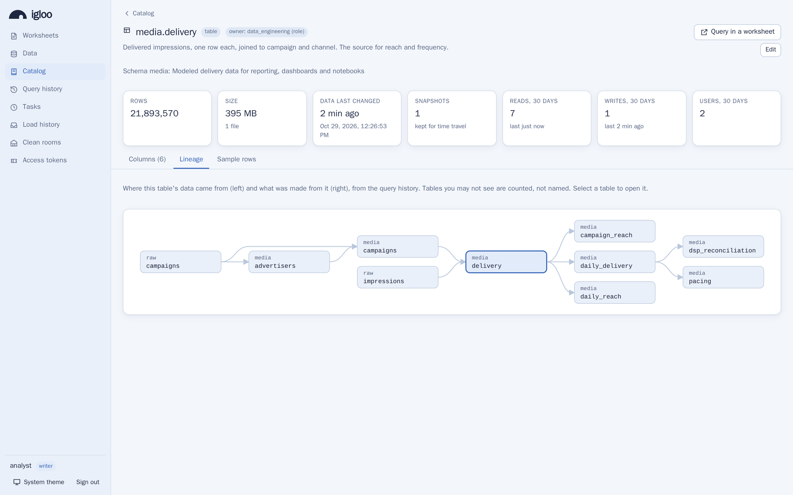

# Data catalog

With hundreds of tables, analysts need to find the right one, know who
answers for it and whether it is fresh, and see where its data came from
and what depends on it. Igloo's catalog keeps that in the warehouse itself:
descriptions and owners of schemas, tables and views, their size and
freshness, how much each is used, and the lineage between them, worked out
from the query history. SQL and the [web console](console.md) show it, and
lineage can also go to [OpenLineage](#openlineage) tools such as Marquez
and DataHub.

Everything the catalog shows is limited to what the user may see (see
[who sees what](#who-sees-what)).

## Finding tables

The console's **Catalog** page searches the names, descriptions, columns,
column descriptions, tags and owners of every table and view you may see,
most used first, and has a page for each: its description, owner, columns
with their descriptions, tags and masking policies, size and freshness,
usage, a sample of its rows and its lineage.

<picture>
  <source media="(prefers-color-scheme: dark)" srcset="assets/screenshots/console-catalog-dark.png">
  
</picture>

In SQL, the same comes from views in the `igloo` schema:

```sql
-- The tables of a schema, with who owns them and how fresh they are
SELECT table_name, table_owner, comment, row_count, bytes, last_altered
FROM igloo.tables WHERE table_schema = 'marts' ORDER BY last_altered DESC;

-- Every column whose name or description mentions a campaign
SELECT table_schema, table_name, column_name, comment
FROM igloo.columns WHERE column_name ILIKE '%campaign%' OR comment ILIKE '%campaign%';

-- The most used tables of the last 30 days
SELECT table_schema, table_name, reads_30d, users_30d, last_read
FROM igloo.table_usage ORDER BY reads_30d DESC LIMIT 20;

SHOW OBJECTS IN SCHEMA marts;
```

## Descriptions

Describe schemas, tables, views and columns with `COMMENT ON`:

```sql
COMMENT ON SCHEMA marts IS 'Reporting tables, rebuilt nightly';
COMMENT ON TABLE marts.daily_spend IS 'Spend per client, campaign and day, in USD';
COMMENT ON COLUMN marts.daily_spend.spend IS 'Media cost, net of fees';
COMMENT ON VIEW marts.active_campaigns IS 'Campaigns with spend in the last 7 days';
COMMENT ON TABLE marts.daily_spend IS NULL;  -- remove
```

They are stored in the Iceberg catalog, where other engines read them too:
a schema's and a table's or view's as their `comment` property, a column's
as its field's doc string. Owners, writers and admins may set them, and
users with `CREATE` on a schema those of its tables and views. They show in
`igloo.schemata`, `igloo.tables` and `igloo.columns`, in
`information_schema`, and to PostgreSQL clients through `obj_description`,
`col_description` and `pg_description` (psql's `\d+`).

## Owners

Every schema, table and view has an owner, a user or a custom role, which
is whoever created it unless changed:

```sql
ALTER TABLE marts.daily_spend OWNER TO analytics_eng;   -- a custom role
ALTER VIEW marts.active_campaigns OWNER TO ana;
ALTER SCHEMA marts OWNER TO analytics_eng;
ALTER MATERIALIZED VIEW marts.weekly OWNER TO ana;
```

An owner is who answers for the object: whom to ask about it. Owning an
object lets its owner, or every member of its owning role, set its
descriptions and hand it to another owner. **It grants nothing else**:
reading, writing, changing and dropping it still take the built-in role or
grants, as for everyone (see [roles and grants](sql.md#roles-and-grants)).
This differs from Snowflake's `OWNERSHIP`, which carries every privilege:
in Igloo, what someone may do with data is decided by grants alone, so
that handing an object to a team, or creating one before losing a role,
never widens anyone's access.

Changing an owner takes what changing the object takes, the writer role
or, for a table or view, `CREATE` on its schema, or being its owner; the
new owner must exist. Owners follow renamed tables. Dropping an object, or
the user or role that owns it, leaves no owner behind. Owners are kept in
the metadata database with the grants, and a change reaches other replicas
within 30 seconds.

Who owns what Igloo did not create from a session:

- Schemas and tables that engines create through Igloo's
  [Iceberg REST catalog](external-engines.md) are owned by the engine's
  Igloo user, and follow renames and drops made there.
- Materialized views, and tables that tasks and pipes create, are owned
  by the job's owner, who runs them.
- An [external table](sharing.md#reading-partners-shares) is owned by the
  admin who created it.
- Connections' tables have no owner in Igloo: their own database answers
  for them.
- Objects created before Igloo recorded owners, or by engines that reach
  the Iceberg catalog without Igloo, have none until one is set.

Owners show in `igloo.tables` (`table_owner`, `owner_type`),
`igloo.schemata` (`schema_owner`), `information_schema.tables`
(`table_owner`), `information_schema.schemata` (`schema_owner`), and
`SHOW OBJECTS`.

## Size and freshness

`igloo.tables` reads each table's size and freshness from its Iceberg
metadata: `row_count`, `bytes` and `file_count` of its current snapshot,
`snapshot_count`, the snapshots that time travel can read, and
`last_altered`, when its data last changed. They cover tables other engines
write too. `row_count` is the rows a query reads: rows that updates,
deletes and materialized view refreshes deleted are not counted, though
they stay in the table's files until maintenance rewrites them. While a
table has equality deletes, which some engines such as Flink write,
`row_count` is `NULL`: which rows those delete, only a query can count. Each replica reads every table's metadata when a query first
needs it, then again in the background every 30 seconds while queries use
it; tables written on the replica are read again a couple of seconds after
the write.

## External tables and connections

`igloo.tables` and `igloo.columns` also list
[external tables](sharing.md#reading-partners-shares) and the tables of
[connections](federation.md), so that search, table pages and lineage
cover data that lives elsewhere:

- An external table is in the catalog's schema it was created in, with
  `table_type` `EXTERNAL TABLE` and its Delta Sharing provider in
  `provider`. Its columns are its view's; Igloo keeps no size, snapshots
  or description of it. Shares and recipients are not in the catalog: they
  are for admins (`SHOW SHARES`, `SHOW RECIPIENTS`), and what recipients
  download is in the query history but not counted as usage.
- A connection's table has the connection's name as `table_catalog` and
  `table_type` `FOREIGN`, and no owner, description, size or freshness.
  The schemas in which the database describes itself (`pg_catalog`,
  `information_schema`, MySQL's `mysql`, `performance_schema` and `sys`)
  are left out.
  Igloo lists them from what DuckDB read of each database when it attached
  the connection or at `ALTER CONNECTION ... REFRESH`, so listing them
  does not query the database. It lists them again in the background, when
  connections change and at most once a minute, and keeps the last listing
  while a database is down.

## Usage

`igloo.table_usage` counts, for the last 30 days, the statements that read
each table and that changed its data (`reads_30d`, `writes_30d`; a comment
is not a write), the users who ran them (`users_30d`), and when it was last
read and written. It is worked out
from the [query history](sql.md#query-history), counting successful
statements only, and a replica reuses its count for a minute.

## Lineage

`igloo.lineage` has one row for each flow of data the query history
records: from a table, or a location files were loaded from, into a table.

```sql
-- Where marts.daily_spend's data comes from
SELECT upstream_type, upstream_schema, upstream_name, last_seen, last_job
FROM igloo.lineage WHERE downstream_schema = 'marts' AND downstream_name = 'daily_spend';

-- What is built from raw.impressions
SELECT downstream_schema, downstream_name, statements, last_seen
FROM igloo.lineage WHERE upstream_schema = 'raw' AND upstream_name = 'impressions';
```

Statements that read tables or files and write a table make edges:
`INSERT ... SELECT`, `CREATE TABLE AS`, `MERGE`, `UPDATE ... FROM`,
`DELETE ... USING`, `COPY INTO` (from its location) and `COPY ... FROM` a
file, and the same statements run by [tasks](loading.md#tasks), the
loads of [pipes](loading.md#pipes) and the refreshes of
[materialized views](loading.md#materialized-views). Reading a view counts
as reading the tables it reads, and reading an external table as reading
that table, not its files. A connection's table is named in full, with the
connection as `upstream_database`, such as `crm.sales.customers` for
`INSERT INTO marts.customers SELECT ... FROM crm.sales.customers`. Each
edge says when it was first and last
seen, how many statements made it, and the latest one: its query ID
(`last_query_id`, which `igloo.query_history` has), user, statement type
and the task, pipe or materialized view it ran for (`last_job`, such as
`task nightly`).

The history records what each statement read and wrote: the tables in
`tables_read` and `tables_written`, the locations in `locations_read`, and
the job in `job`. For users with the role none these are exactly the tables
their grants were checked for. For everyone else Igloo works them out from
DuckDB's parse of the statement, with names resolved as DuckDB resolves
them and views expanded, in the background after the statement, so no
statement waits for it.

Lineage reaches back as far as the history, `IGLOO_AUDIT_RETENTION` (90
days by default), and needs the history on (`IGLOO_AUDIT`).

**Not seen:** reads through macros, through table functions that read
tables by name (`query_table`), or through the session's temporary views;
statements of several in one query; and anything other engines do to the
Iceberg tables directly. Edges keep the names tables had when the
statements ran.

**Column-level lineage** is not available. DuckDB's parse
(`json_serialize_sql`) covers only queries, not the `INSERT`, `MERGE` or
`CREATE TABLE AS` around them, and leaves column references unresolved:
`*` unexpanded, unqualified names unbound to a table, views' columns
unknown. Its plans bind columns, but by position, through projections,
aggregates and joins that do not say where a value came from, and Iceberg
scans in them do not name their table. Igloo would have to reimplement
DuckDB's binder to follow a column, and a lineage that is sometimes wrong
is worse than none, so it stops at tables.

## Who sees what

The catalog shows each user only what they may see, which is what they may
read or change:

- Users with the reader, writer or admin role read every table, so they see
  every schema, table and view, the locations files were loaded from, and
  the lineage between them.
- A user with the role none sees the tables and views they have a grant
  on (any privilege, on the object or its schema) or own, and the schemas
  those are in. Of every other object they learn nothing from the catalog:
  not its name, description, owner, tags, size or usage, in search, in
  `igloo.tables` and the other views, in `igloo_comments()` and
  `pg_description`, or in `igloo.policy_references` and
  `igloo.tag_references`.
- A connection's table shows, as it is read, to admins and to whoever has
  a grant on it, its schema or its connection; the built-in roles do not
  cover connections, so readers and writers see none without a grant.
- An edge of the lineage between a table they may see and one they may
  not shows the latter without a name, and says nothing else about it:
  the console draws "1 hidden upstream table". An edge between two tables
  they may not see does not show. Locations show only to users who may
  read files, the reader role and above. External tables' files, which
  Igloo's sharing proxy serves under a secret address, are never recorded
  as locations.
- Which statement or job made an edge, and who ran it, shows only to those
  who may see that statement in the query history: its user and admins.
  Everyone else who may see both tables sees that the data flows, and how
  many statements made the flow, but not which ones.
- Sample rows run as the user, through their grants and
  [policies](security-policies.md): masked columns stay masked.
- A [clean room](clean-rooms.md)'s datasets and result tables show only to
  their own party, whatever anyone else's role, admins included, and no
  edge to or from one shows to anyone else, not even without its name.

Table and column names stay visible to every user through the system
catalogs (`information_schema`, `pg_catalog`, `duckdb_tables()`), as before;
what `information_schema.tables` adds (owners, descriptions, sizes) is
limited like the rest.

## OpenLineage

With `IGLOO_OPENLINEAGE_URL` set, every statement that writes a table is
also sent as an [OpenLineage](https://openlineage.io) `COMPLETE` run event,
so Marquez, DataHub and other OpenLineage consumers draw Igloo's lineage
next to that of the rest of the stack. The run's ID is the statement's
query ID; its inputs are the tables and locations it read, its outputs the
tables it wrote, named `catalog.schema.table` in the namespace
`IGLOO_OPENLINEAGE_NAMESPACE` (locations in their bucket's, such as
`s3://landing`). Tasks, pipes and materialized views are jobs of their own
(`task.nightly`, `pipe.drops`, `materialized_view.marts.weekly`); other
statements are jobs named after the table they wrote (`sql.lake.marts.daily_spend`).

| Variable | Default | Meaning |
|---|---|---|
| `IGLOO_OPENLINEAGE_URL` | | Where events are POSTed, such as `https://marquez.example.com/api/v1/lineage` or DataHub's `/openapi/openlineage/api/v1/lineage`. Empty sends nothing. |
| `IGLOO_OPENLINEAGE_API_KEY` | | Sent as a bearer token. |
| `IGLOO_OPENLINEAGE_NAMESPACE` | `igloo` | The namespace of Igloo's jobs and tables in events. |
| `IGLOO_OPENLINEAGE_SEND_SQL` | `false` | Include each statement's text (with passwords and secrets removed, as in the history). |
| `IGLOO_OPENLINEAGE_ALLOW_PRIVATE` | `false` | Allow an endpoint at a private or loopback address, and `http`. |

Only whoever configures Igloo chooses the endpoint; SQL cannot. Events say
what data moved where, never the data: no query results and no values, and
the statement's text only with `IGLOO_OPENLINEAGE_SEND_SQL`. The endpoint
must be `https`. Requests go to private addresses (loopback, private
networks, unique and site-local IPv6, carrier-grade NAT, benchmarking
networks) only with `IGLOO_OPENLINEAGE_ALLOW_PRIVATE=true`, and never to
link-local, multicast, unspecified or reserved addresses, nor to cloud
metadata services elsewhere (`100.100.100.200`, `fd00:ec2::254`). IPv6
addresses that carry an IPv4 one (mapped, translated, NAT64, 6to4) are
judged by it, and those whose IPv4 address cannot be read (IPv4-compatible,
Teredo, local-use NAT64) are refused. Igloo resolves the endpoint's name
once per connection, refuses it if any of its addresses is refused, and
connects to the addresses it checked, so a name cannot be pointed
elsewhere in between. Redirects are not followed, and requests never go
through an HTTP proxy, whatever the environment says.

Events are sent in the background and tried three times. When the endpoint
is slow or down, events are dropped rather than slowing statements down,
and `igloo_openlineage_events_total{result="sent|failed|dropped"}` counts
them. Like lineage, events need the query history on.

## Reference

| `igloo.tables` column | Meaning |
|---|---|
| `table_catalog`, `table_schema`, `table_name` | The table or view |
| `table_type` | `BASE TABLE`, `VIEW`, `EXTERNAL TABLE` or, for a connection's table, `FOREIGN` |
| `table_owner`, `owner_type` | Its owner and whether that is a `user` or `role`; `NULL` without one |
| `comment` | Its description |
| `provider` | For an external table, the Delta Sharing provider it reads |
| `row_count`, `bytes`, `file_count` | Of its current snapshot, for tables: the rows a query reads, without deleted rows (`NULL` while it has equality deletes), and its data files and their size |
| `snapshot_count` | Snapshots time travel can read, for tables |
| `last_altered` | When its data last changed, or a view was last replaced |
| `clustering_key` | Its [clustering key](sql.md#sort-orders-and-clustering), as Snowflake shows one: `LINEAR(customer_id, day DESC)`; `NULL` for tables without one |

| View | Columns |
|---|---|
| `igloo.schemata` | `catalog_name`, `schema_name`, `schema_owner`, `owner_type`, `comment` |
| `igloo.columns` | `table_catalog`, `table_schema`, `table_name`, `column_name`, `ordinal_position`, `data_type`, `comment` |
| `igloo.table_usage` | `table_catalog`, `table_schema`, `table_name`, `reads_30d`, `writes_30d`, `users_30d`, `last_read`, `last_written` |
| `igloo.lineage` | `upstream_type` (`TABLE` or `LOCATION`), `upstream_database`, `upstream_schema`, `upstream_name`, `downstream_database`, `downstream_schema`, `downstream_name`, `first_seen`, `last_seen`, `statements`, `last_query_id`, `last_user`, `last_statement_type`, `last_job` |

`information_schema.tables` has, besides its own columns, `table_owner`,
`comment`, `row_count`, `bytes`, `last_altered` and `clustering_key`, as in
Snowflake, and
its `TABLE_COMMENT` is filled in for Iceberg tables;
`information_schema.schemata` has the real `schema_owner` and `comment`.
Their own columns, rows and table types are DuckDB's, connections'
catalogs included, so tools that list tables through them, such as Flight
SQL clients' `GetTables`, see what they did before.

`SHOW OBJECTS [IN SCHEMA name]` lists the catalog's schemas, tables, views
and external tables (`kind` `EXTERNAL TABLE`) with `schema_name`, `name`,
`kind`, `owner`, `owner_type`, `comment`, `row_count`, `bytes`,
`last_altered` and `cluster_by` (a table's clustering key, as in Snowflake's
`SHOW TABLES`); connections' tables, which are not in the catalog's
schemas, show in `igloo.tables` only.

## Cost

The catalog adds no work to queries. Working out what a statement read and
wrote runs in the background, on a DuckDB of its own that only parses, for
writes and for queries that name a table; when too many wait, statements
are recorded without it. Each replica reads every table's Iceberg metadata, a
request per table, when a query first needs it and then at most every 30
seconds while the catalog is in use. Lineage and usage are counted by the
metadata database from the history, usage at most once a minute per
replica.
